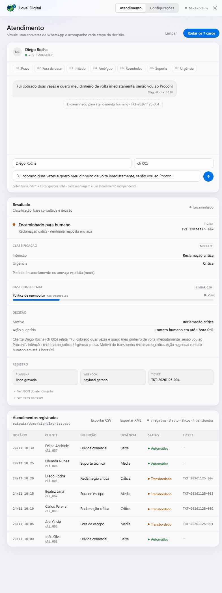
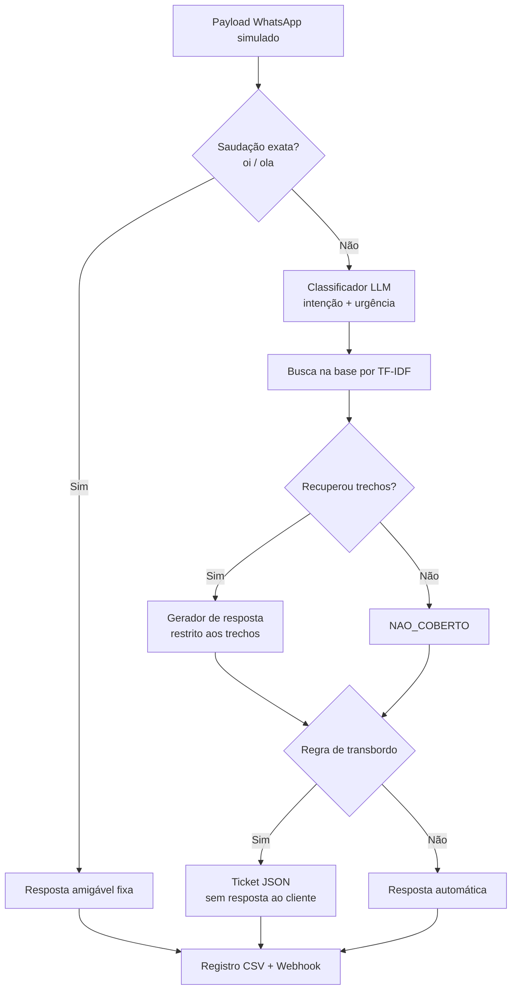

<p align="center">
  
</p>

<h1 align="center">Lovel Digital — Atendimento automático via WhatsApp</h1>

<p align="center">
  Protótipo funcional de triagem e resposta automática de mensagens de clientes,<br>
  com <strong>IA usada com limites</strong> e <strong>regras de negócio determinísticas</strong>.
</p>

<p align="center">
  
  
  
  
</p>

---

## Início rápido

```bash
git clone <URL-DO-SEU-REPOSITORIO> lovel-digital
cd lovel-digital
python -m venv .venv
source .venv/bin/activate          # Windows: .venv\Scripts\Activate.ps1
pip install -r requirements.txt
MOCK_LLM=1 python -m src.demo_server --open
```

> No **Windows (PowerShell)**, troque a última linha por
> `$env:MOCK_LLM="1"; python -m src.demo_server --open`.

A demo abre em **http://127.0.0.1:8000**. Para rodar só o fluxo no terminal:
`MOCK_LLM=1 python -m src.main --all`.

---

## Índice

1. [O que é este projeto](#1-o-que-é-este-projeto)
2. [Requisitos](#2-requisitos)
3. [Instalação](#3-instalação)
4. [Como rodar](#4-como-rodar)
5. [Arquitetura](#5-arquitetura)
6. [Onde há IA vs. regra fixa](#6-onde-há-ia-vs-regra-fixa)
7. [Como evitamos alucinações](#7-como-evitamos-alucinações)
8. [Configuração](#8-configuração)
9. [Saídas e exportação (CSV / XML)](#9-saídas-e-exportação-csv--xml)
10. [Saudação automática ("oi" / "ola")](#10-saudação-automática-oi--ola)
11. [Integração com a API do WhatsApp](#11-integração-com-a-api-do-whatsapp)
12. [Fluxo demonstrável — 7 casos simulados](#12-fluxo-demonstrável--7-casos-simulados)
13. [Testes automatizados](#13-testes-automatizados)
14. [Estrutura de arquivos](#14-estrutura-de-arquivos)
15. [Limitações e próximos passos](#15-limitações-e-próximos-passos)
16. [Deploy no Vercel (opcional)](#16-deploy-no-vercel-opcional)
17. [Licença](#17-licença)

---

## 1. O que é este projeto

A **Lovel Digital** é uma empresa fictícia de eletrônicos usada como cenário de
um protótipo de atendimento de primeiro nível no WhatsApp. O sistema recebe a
mensagem do cliente, entende o assunto e a urgência, consulta uma base de
conhecimento fechada e então decide entre:

- **responder automaticamente** (quando há cobertura na base e nenhuma regra de
  risco é acionada); ou
- **transbordar para um humano** (quando há risco, reclamação crítica ou o
  assunto não está coberto), abrindo um ticket estruturado.

Tudo é registrado em **CSV**, **tickets JSON** e **payloads de webhook
simulados**, e pode ser visualizado em uma **demo web local** com tema claro e
escuro.

> O princípio central do projeto: **a IA ajuda a entender e redigir, mas nunca
> decide sozinha sobre dinheiro, cancelamento ou cobertura.** Essas decisões são
> regras explícitas de código, testáveis e auditáveis.

---

## 2. Requisitos

- **Python 3.11 ou superior** (validado em 3.11–3.14).
- `pip`.
- Opcional: **chave da OpenAI** (`OPENAI_API_KEY`) para usar o LLM real.
  Sem a chave, o projeto roda 100% offline com um mock determinístico.

Dependências (em `requirements.txt`):

| Pacote | Para quê |
|---|---|
| `openai` | Classificação e redação com `gpt-4o-mini` (modo real) |
| `scikit-learn` | Busca por similaridade TF-IDF na base de conhecimento |
| `python-dotenv` | Leitura do arquivo `.env` |
| `flask` | Adaptador WSGI usado **somente** no deploy do Vercel |
| `pytest` / `pytest-mock` | Testes automatizados |

Não é necessário banco de dados, servidor web externo ou Docker. O demo local
usa apenas a biblioteca padrão do Python (`http.server`); o Flask entra só no
deploy serverless (veja a [seção 16](#16-deploy-no-vercel-opcional)).

---

## 3. Instalação

```bash
# 1. Clone o repositório
git clone <URL-DO-SEU-REPOSITORIO> lovel-digital
cd lovel-digital

# 2. Crie e ative um ambiente virtual
python -m venv .venv

# Linux / macOS
source .venv/bin/activate

# Windows (PowerShell)
.venv\Scripts\Activate.ps1

# 3. Instale as dependências
pip install -r requirements.txt
```

Opcional — para usar o LLM real:

```bash
cp .env.example .env
# edite .env e preencha: OPENAI_API_KEY=sk-...
```

> Sem `OPENAI_API_KEY`, o sistema entra automaticamente em **modo offline
> (mock)**. Para forçar o offline mesmo tendo chave, defina `MOCK_LLM=1`.

---

## 4. Como rodar

### 4.1. Linha de comando (todos os 7 casos)

```bash
# Linux / macOS
MOCK_LLM=1 python -m src.main --all

# Windows (PowerShell)
$env:MOCK_LLM = "1"
python -m src.main --all
```

Saída esperada:

```
Casos processados : 7
Respondidos auto  : 3
Transbordados     : 4
CSV               : .../outputs/atendimentos.csv
Tickets           : 4 arquivo(s)
Webhooks          : 7 arquivo(s)
```

O `--all` limpa apenas os artefatos gerados pelo app
(`outputs/atendimentos.csv`, `outputs/tickets/TKT-*.json`,
`outputs/webhook_payloads/*.json`) para a execução ser reproduzível.

### 4.2. Linha de comando (um caso isolado)

```bash
python -m src.main data/simulated_messages/case_05_reembolso_critico.json
```

Um caso isolado **acrescenta** ao CSV e continua a numeração de tickets do dia.

### 4.3. Demo web interativa

```bash
# Linux / macOS
MOCK_LLM=1 python -m src.demo_server --open

# Windows (PowerShell)
$env:MOCK_LLM = "1"
python -m src.demo_server --open
```

Abre em **http://127.0.0.1:8000**. Para outra porta:

```bash
python -m src.demo_server --port 8001 --open
```

A demo usa o **mesmo** `processar_mensagem` do CLI e grava em `outputs/demo/`,
sem alterar os artefatos canônicos de `outputs/`.



### 4.4. Com Make (Linux / macOS / WSL)

```bash
make install     # pip install -r requirements.txt
make test        # MOCK_LLM=1 pytest -v
make run case=05 # roda um caso
make demo        # roda todos os casos
make demo-ui     # sobe a demo web
```

> No Windows, `make` não vem instalado por padrão. Use os comandos PowerShell
> acima, que são equivalentes.

---

## 5. Arquitetura



Ordem de execução em `src/main.py` → `processar_mensagem()`:

1. **Validação do payload** — campos obrigatórios e não vazios; erro claro se faltar algo.
2. **Atalho de saudação** — se a mensagem for exatamente `oi` ou `ola`, responde
   com uma saudação amigável fixa (sem chamar o LLM e sem transbordar).
3. **Classificação** (`src/classifier.py`) — intenção + urgência + justificativa.
4. **Recuperação** (`src/knowledge_base.py`) — TF-IDF sobre tópico, palavras-chave
   e resposta de cada FAQ; retorna até `top_k` FAQs com score ≥ `limiar`.
5. **Geração** (`src/responder.py`) — sem trechos, retorna `NAO_COBERTO` **sem
   chamar o LLM**. Com trechos, o LLM recebe **apenas** esses trechos.
6. **Transbordo** (`src/escalation.py`) — quatro regras fixas, em ordem.
7. **Persistência** (`src/recorder.py`) — ticket (se houver), linha no CSV e webhook.
8. **Retorno** do `ResultadoAtendimento`.

### Módulos principais

| Módulo | Responsabilidade |
|---|---|
| `src/main.py` | Orquestra o fluxo e expõe `processar_mensagem()` |
| `src/models.py` | Dataclasses e enums de domínio |
| `src/classifier.py` | Prompt e validação defensiva da classificação |
| `src/knowledge_base.py` | Busca TF-IDF e CRUD/validação da base |
| `src/responder.py` | Prompt restrito e normalização de `NAO_COBERTO` |
| `src/escalation.py` | Regras determinísticas de transbordo e ticket |
| `src/recorder.py` | CSV, tickets e webhooks (sem rede) |
| `src/llm_client.py` | Wrapper da OpenAI e mock determinístico |
| `src/config.py` | Configuração única, validação e gravação atômica |
| `src/export.py` | Exportação dos atendimentos em CSV e XML |
| `src/demo_server.py` | Roteador HTTP comum + servidor local (stdlib) |
| `src/demo_ui.html` | Interface da demo (chat + pipeline + configurações) |
| `app.py` | Adaptador WSGI/Flask que usa o mesmo roteador no Vercel |

---

## 6. Onde há IA vs. regra fixa

| Etapa | IA (LLM) | Regra fixa (código) |
|---|---|---|
| Saudação | — | `oi` / `ola` exatos → resposta amigável fixa, sem transbordo |
| Entender a mensagem | Classifica intenção e urgência e justifica | Valida o JSON contra os enums; qualquer campo inválido → `fora_de_escopo` + `media` |
| Buscar na base | — | TF-IDF (`ngram_range=(1,2)`, sem acentos, stopwords PT) e limiar configurável |
| Redigir a resposta | Reescreve de forma cordial usando **somente** os trechos recuperados | Não chama o gerador sem trechos; normaliza vazio/`NAO_COBERTO` para transbordo |
| Decidir transbordo | **Nunca decide** | Reclamação crítica, termos críticos, falta de cobertura, fora de escopo urgente |
| Registrar e exportar | — | CSV determinístico, ticket JSON, webhook simulado, export CSV/XML |

Pontos importantes:

- **O LLM não tem poder de veto.** Se a regra disser "transbordar", transborda —
  mesmo que o LLM tenha produzido uma resposta bonita.
- **O LLM não recebe a base inteira** nem acesso a ferramentas: recebe só os
  trechos recuperados.
- **A decisão de cobertura é matemática** (similaridade), não do modelo.
- **A saudação é uma regra determinística**, não uma geração de texto: a resposta
  é um texto fixo da configuração.

---

## 7. Como evitamos alucinações

1. **RAG fechado.** O prompt do gerador contém apenas os trechos recuperados, com
   a instrução de responder `NAO_COBERTO` caso eles não bastem.
2. **Curto-circuito sem cobertura.** Se a busca não retorna nenhum FAQ acima do
   limiar, o gerador **nem é chamado** — a resposta já nasce `NAO_COBERTO`.
3. **Stopwords em português.** A busca remove palavras funcionais ("de", "para",
   "com") para evitar falsos positivos em documentos curtos.
4. **Validação pós-LLM.** Resposta vazia ou que contenha `NAO_COBERTO`
   (case-insensitive) é convertida em `NAO_COBERTO` e força transbordo.
5. **Parser defensivo.** JSON inválido, campo faltando, categoria inventada,
   erro de rede/timeout ou SDK ausente → `fora_de_escopo` + `media` e transbordo
   por falta de cobertura. O fluxo nunca "chuta" uma categoria.
6. **Lista fechada no prompt.** Os valores permitidos de intenção e urgência
   estão no system prompt **e** são revalidados em Python.
7. **Transbordo por regra, não por confiança do modelo.** Termos como `procon`,
   `advogado`, `processo`, `cancelamento` e `reembolso` são detectados por código,
   com normalização de acentos.
8. **Testes offline e determinísticos.** O mock não usa rede e os testes cobrem
   respostas, transbordos, saudação e exportação.
9. **O gerador nunca roda antes da base.** A única chamada de LLM anterior à
   busca é o classificador, que não redige nada para o cliente.

**O que não está coberto:** o classificador ainda pode errar a intenção em
mensagens muito ambíguas (ex.: ironia). Por isso o desenho favorece o **falso
positivo de encaminhar para humano**, e há uma regra específica para fora de
escopo com urgência alta/crítica.

---

## 8. Configuração

Toda a configuração fica em **`config/lovel.json`** e pode ser editada pela aba
**Configurações** da demo web. As alterações valem na hora (sem reiniciar).

Precedência de carregamento:

1. `MOCK_LLM=1` no ambiente → força o modo offline.
2. Caminhos alternativos no ambiente: `LOVEL_CONFIG` (config),
   `LOVEL_KB` (base), `LOVEL_DEMO_DIR` (artefatos da demo) e
   `LOVEL_OUTPUT_DIR` (saída do CLI).
3. `config/lovel.json`.
4. Valores padrão internos (usados quando falta uma chave).

### O que é configurável

| Seção | Conteúdo |
|---|---|
| **Empresa** | Nome e horário de atendimento humano |
| **Assistente** | Modo (`auto`/`mock`/`real`), modelo, temperatura, tokens |
| **Busca na base** | Arquivo da base, limiar de similaridade (0–1), trechos por consulta |
| **Base de conhecimento** | Adicionar/editar/remover FAQs + testador de similaridade embutido |
| **Transbordo** | Ligar/desligar cada regra, termos críticos (1 por linha), prazos por urgência |
| **Registro** | CSV, tickets e webhook ligados/desligados; diretório de saída |
| **Servidor** | Host e porta da demo |
| **WhatsApp API** | URL, token, `phone_number_id`, versão da API (modo simulado) |

Exemplo de trecho:

```json
{
  "empresa": { "nome": "Lovel Digital" },
  "base": { "limiar": 0.1, "top_k": 3 },
  "llm": { "modo": "auto", "model": "gpt-4o-mini", "temperature": 0.0 },
  "whatsapp": {
    "enabled": false,
    "api_url": "https://graph.facebook.com/v21.0/me/messages",
    "token": "",
    "phone_number_id": "",
    "versao_api": "v21.0"
  }
}
```

---

## 9. Saídas e exportação (CSV / XML)

Cada atendimento grava três artefatos em `outputs/`:

### 9.1. `outputs/atendimentos.csv`

Cabeçalho exato:

```csv
timestamp,cliente_id,nome,intencao,urgencia,status,resposta_gerada,ticket_id,motivo_transbordo
```

O campo `resposta_gerada` fica **vazio** quando há transbordo (nada é enviado ao
cliente). O `timestamp` da linha é o da mensagem simulada; o ticket e o webhook
usam o horário real de processamento (UTC).

### 9.2. `outputs/tickets/TKT-AAAAMMDD-NNN.json`

Ticket estruturado com cliente, mensagem original, classificação, motivo do
transbordo, resumo para o humano e ação sugerida (prazo por urgência).

### 9.3. `outputs/webhook_payloads/<cliente>_<timestamp>.json`

Payload pronto para um nó HTTP (n8n / Make), com evento, cliente, intenção,
urgência, status, resposta e `ticket_id`.

### 9.4. Exportação pela interface

Na demo web, o cartão **Atendimentos registrados** tem dois botões:

- **Exportar CSV** → baixa `atendimentos.csv` (separador `;`, UTF-8).
- **Exportar XML** → baixa `atendimentos.xml` (raiz `<atendimentos>`, um
  `<atendimento>` por linha).

Isso também está disponível por HTTP:

```bash
GET /api/export/csv
GET /api/export/xml
```

Ambos respondem com `Content-Disposition: attachment`, prontos para download.

---

## 10. Saudação automática ("oi" / "ola")

Quando a mensagem é **exatamente** `oi` ou `ola` (ignorando maiúsculas e espaços
nas pontas), o sistema:

- classifica como `saudacao` (urgência `baixa`);
- responde automaticamente: **"Olá! Como posso te ajudar hoje?"**;
- **não** abre ticket e **não** transborda;
- registra normalmente no CSV e no webhook.

Mensagens mais longas (ex.: "oi, preciso de ajuda com meu pedido") **não** caem
nessa regra — seguem o fluxo normal de classificação e busca.

---

## 11. Integração com a API do WhatsApp

O protótipo é um **simulador**: o payload é local e as respostas são gravadas em
disco. Ainda assim, há um lugar dedicado para a configuração da API oficial do
WhatsApp Business (Meta Cloud API), na seção **WhatsApp API** das Configurações
ou no bloco `whatsapp` de `config/lovel.json`:

| Campo | Descrição |
|---|---|
| `enabled` | Liga/desliga o uso da API no simulador |
| `api_url` | Endpoint de envio (padrão: `graph.facebook.com/v21.0/me/messages`) |
| `token` | Token de acesso da API |
| `phone_number_id` | ID do número de telefone |
| `versao_api` | Versão da Graph API |

Para uma integração real, o próximo passo é receber o webhook da Meta, extrair a
mensagem e chamar o mesmo `processar_mensagem`, devolvendo a resposta pela API.
O restante do fluxo (classificação, base, transbordo, registro) permanece igual.

---

## 12. Fluxo demonstrável — 7 casos simulados

O projeto entrega **7 casos simulados** (acima do mínimo de 6) e cobre os
cenários pedidos: dúvida simples, pergunta fora da base, cliente irritado,
entrada incompleta/ambígua, risco jurídico, suporte técnico e urgência coberta.

Para ver o fluxo inteiro de uma vez:

```bash
MOCK_LLM=1 python -m src.main --all
```

Ou abra a demo, clique em **Rodar os 7 casos** e acompanhe cada etapa do
pipeline (classificação → busca → decisão → registro).

| # | Arquivo | Entrada (resumo) | Intenção | Urgência | Status | Motivo do transbordo |
|---|---|---|---|---|---|---|
| 01 | `case_01_simples.json` | Prazo para o CEP 01310-100 | `duvida_comercial` | `baixa` | `RESPONDIDO_AUTOMATICO` | — |
| 02 | `case_02_fora_da_base.json` | Vende cartucho de tinta Epson? | `fora_de_escopo` | `media` | `TRANSBORDADO` | `nao_coberto_pela_base` |
| 03 | `case_03_irritado.json` | "Absurdo! Quero cancelar agora…" | `reclamacao_critica` | `critica` | `TRANSBORDADO` | `reclamacao_critica` |
| 04 | `case_04_ambiguo.json` | "Oi, preciso de ajuda com uma coisa." | `fora_de_escopo` | `media` | `TRANSBORDADO` | `nao_coberto_pela_base` |
| 05 | `case_05_reembolso_critico.json` | Cobrança dupla + dinheiro de volta + Procon | `reclamacao_critica` | `critica` | `TRANSBORDADO` | `reclamacao_critica` |
| 06 | `case_06_suporte_tecnico.json` | Não consigo login, esqueci a senha | `suporte_tecnico` | `media` | `RESPONDIDO_AUTOMATICO` | — |
| 07 | `case_07_urgencia_alta_coberta.json` | Atraso + urgência para amanhã + CEP | `duvida_comercial` | `baixa` (mock) | `RESPONDIDO_AUTOMATICO` | — |

Notas:

- O caso 05 contém "dinheiro de volta" **e** "Procon". Pela ordem das regras, a
  reclamação crítica dispara primeiro.
- O caso 07 é o contraexemplo: há urgência percebida, mas **nenhum termo
  crítico** e a base cobre o prazo — então responde.
- O caso 04 é ambíguo: sem assunto recuperável, a falta de cobertura gera o
  transbordo.

---

## 13. Testes automatizados

```bash
# Linux / macOS
MOCK_LLM=1 pytest -v

# Windows (PowerShell)
$env:MOCK_LLM = "1"
pytest -v
```

Resultado atual: **12 testes passando**, todos offline (sem rede):

- 7 testes de caso (01 a 07);
- 1 teste agregado dos artefatos (CSV, tickets, webhooks);
- 2 testes de saudação (`oi` e `ola`);
- 2 testes de exportação (CSV e XML).

---

## 14. Estrutura de arquivos

```
lovel-digital/
├── assets/
│   ├── logo.png              # logo original completa (README)
│   ├── logo-mark.png         # globo recortado (cabeçalho da UI)
│   └── favicon.png           # ícone da aba
├── config/
│   └── lovel.json            # configuração única (editável pela UI)
├── data/
│   ├── knowledge_base.json   # FAQs
│   └── simulated_messages/   # 7 casos de exemplo
├── docs/
│   └── demo.png              # captura da demo
├── src/
│   ├── __init__.py
│   ├── main.py
│   ├── models.py
│   ├── classifier.py
│   ├── knowledge_base.py
│   ├── responder.py
│   ├── escalation.py
│   ├── recorder.py
│   ├── llm_client.py
│   ├── config.py
│   ├── export.py
│   ├── demo_server.py        # roteador + servidor local (stdlib)
│   └── demo_ui.html
├── tests/
│   ├── __init__.py
│   └── test_flow.py
├── outputs/                  # artefatos canônicos (CSV, tickets, webhooks)
├── app.py                    # adaptador WSGI/Flask para o Vercel
├── vercel.json               # configuração do deploy
├── .vercelignore
├── .env.example
├── .gitignore
├── Makefile
├── pytest.ini
├── requirements.txt
└── README.md
```

---

## 15. Limitações e próximos passos

- **TF-IDF é frágil para sinônimos e paráfrases.** Próximo passo natural:
  embeddings locais (`sentence-transformers`) mantendo o mesmo limiar de decisão.
- **Mock ≠ LLM real.** A demo prova o fluxo e as guardas, não a acurácia do
  `gpt-4o-mini`. Falta um conjunto rotulado maior para medir precision/recall.
- **Sem memória de conversa.** Cada mensagem é tratada isoladamente.
- **Persistência em arquivo.** Produção pede SQLite/Postgres e idempotência por
  `message_id`.
- **Sem integração real com o WhatsApp.** O payload é simulado; a troca seria
  pelo webhook da Meta Cloud API, mantendo o mesmo `processar_mensagem`.
- **Sem PII/LGPD.** Telefones aparecem em claro nos artefatos. Em produção:
  mascarar, criptografar e definir retenção.
- **Demo web local e sem autenticação.** Escuta em `127.0.0.1` por padrão; não
  exponha em rede sem autenticação e TLS.

---

## 16. Deploy no Vercel (opcional)

O projeto está pronto para um teste público no Vercel. O `app.py` é um adaptador
WSGI (Flask) que chama o **mesmo** roteador do demo local
(`src/demo_server.py → responder()`), então as rotas e as regras são idênticas
— não existe uma "versão Vercel" com comportamento diferente.

### Opção A — CLI

```bash
npm i -g vercel
vercel
```

Na primeira vez, aceite as perguntas padrão (o framework é detectado como
Flask). Para publicar em produção: `vercel --prod`.

### Opção B — painel

1. Envie o repositório para o GitHub.
2. Em [vercel.com/new](https://vercel.com/new), importe o repositório.
3. Não é preciso configurar *build command* nem *output directory*: o Vercel
   detecta `app.py` + `requirements.txt`.
4. Clique em **Deploy**. A URL pública já abre a demo.

### Variáveis de ambiente (opcionais)

| Variável | Efeito |
|---|---|
| `MOCK_LLM=1` | Força o modo offline. Já é o padrão no Vercel. |
| `OPENAI_API_KEY` | Liga o LLM real; use junto com `MOCK_LLM=0`. |
| `LOVEL_CONFIG` / `LOVEL_KB` / `LOVEL_DEMO_DIR` / `LOVEL_OUTPUT_DIR` | Sobrescrevem caminhos. O `app.py` já aponta tudo para `/tmp`. |

### O que muda no Vercel

- **Disco efêmero.** Configurações editadas, FAQs e atendimentos ficam em
  `/tmp` e somem quando a instância é reciclada. O CSV/XML continua funcionando
  durante a vida da instância; para persistência real, use banco de dados ou
  Vercel Blob.
- **Modo mock por padrão.** A demo pública não gasta tokens nem exige chave.
- **Cold start.** A primeira requisição pode levar alguns segundos (import do
  scikit-learn + cópia dos arquivos para `/tmp`).
- **Sem autenticação.** É uma demo. Não coloque dados reais de clientes.

O demo local continua sendo a experiência completa (persistência em `outputs/`,
edição de config/base e exportação).

---

## 17. Licença

Este projeto é um protótipo de estudo. **Defina uma licença antes de publicar**
(ex.: MIT, Apache-2.0) e adicione o arquivo `LICENSE` correspondente.

---

<p align="center">
  <sub>Feito para demonstrar atendimento automático com IA sob controle — sem inventar política, prazo ou valor.</sub>
</p>
